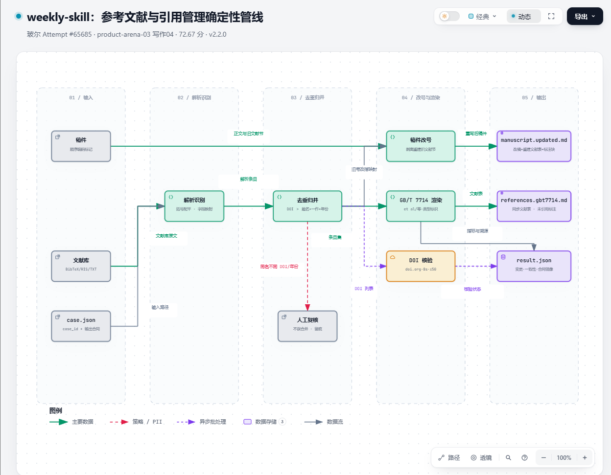

# weekly-skill — 参考文献与引用管理确定性管线

给定一份稿件和一份文献库（BibTeX / RIS / CSL-JSON / 纯文本编号列表），自动完成**文献去重归并、正文引用编号连锁更新、参考文献节重建、GB/T 7714—2015 顺序编码制渲染、DOI 校验与可选在线核验**，输出可编辑改稿、同步文献表与结构化审计结果。单文件、纯标准库、离线可跑，每一步判断都写明证据、全程可回溯。



> 架构图使用 [archify](https://play.bohrium.com) 绘制（Attempt #65685 提交版本的管线设计）。

## 解决什么问题

写综述 / 投稿整理参考文献时的三类麻烦：

- **收不净**：同一篇文献从 Zotero、EndNote、合作者手贴的 BibTeX 等不同来源导入，仅因一条带页码、一条没带就被当成两条，引用进文献表时重复出现；
- **编不对**：手动合并 / 增删条目后，正文 `[1]`、`[2,3]`、`[4-6]` 式编号要一路改到文末，错一处全文错位；
- **合错更糟**：把两篇同名的不同文献（如 arXiv 预印本与正式版）并成一条，比不合并危害更大。

本工具把「合并判据 + 连锁改号 + 双向一致性校验」固化为确定性代码：判据、例外与降级路径全部写进 `result.json`，可直接复核。

## 特性

- **四格式文献库**自动识别：BibTeX（逐 `@` 扫描 + 括号配平）、RIS（`TY/ER` 记录映射）、CSL-JSON（字段映射）、纯文本编号列表（启发式，标注低置信）；
- **可解释去重**：两级判据 `DOI_EXACT`（归一化 DOI 一致）＞ `TITLE_AUTHOR_YEAR`（题名归一化 + 第一作者姓 + 年份一致，且双侧无合法 DOI）；同名不同 DOI / 年份**坚决不合并**，标记转人工复核并给出理由；
- **编号连锁更新**：按正文首次引用顺序重排（GB/T 7714 顺序编码制），被合并条目旧标记改指保留条目，未引用条目按原序补在列表末尾并标注，dangling 标记保留原号、不删句、不改正文论断；
- **原稿已有文献节的识别与重建**：带标题时只剥离「该标题到下一同级/更高标题之间」的旧文献区，其后附录 / 图注原样保留；无标题的末尾编号列表按内容级书目证据判定（过半行具备 DOI / 类型标识 / 作者+年份等），普通结论 / 配料 / 程序清单不误删；
- **GB/T 7714—2015 渲染**：作者「姓大写 + 名首字母」、>3 人截断「前 3 + et al./等」（末段截断标记不再误当作者名）、`[J]/[M]/[C]/[D]/[R]/[EB/OL]` 类型标识、仅渲染通过格式校验的 DOI；
- **正文—文献表双向一致性检查**：区分未引用条目与悬空标记，机器可查字段落盘（`result.json → consistency`）；
- **诚实降级**：非法 DOI 不渲染、记 `invalid_format_not_verifiable`；在线核验默认关闭，未开启如实记 `not_attempted`；输入缺失 exit 2 仍写出 result.json（不抛崩溃栈）；
- **确定性可复现**：无随机源，同输入同输出（selfcheck S9 验证）；Python 3.8+ 仅标准库，零 pip 依赖，UTF-8 / UTF-8 BOM / GB18030 自适应。

## 快速开始

```bash
python scripts/citation_pipeline.py \
  --manuscript 你的稿件.md \
  --refs 你的文献库.bib \
  --outdir out
```

评测 / 比赛场景可用 `--case /input/case.json` 让 case.json 提供 `case_id`、`inputs.manuscript`、`inputs.refs` 并原样镜像 `output_contract`（相对路径按 case.json 所在目录解析）。

### 最小示例（`examples/mini/`，自建样例）

输入 3 条 BibTeX，其中 `demoA` 与 `demoAdup` 为 DOI 相同的重复条目（题名 / 作者写法不同）：

```bash
python scripts/citation_pipeline.py \
  --manuscript examples/mini/ms_mini.md \
  --refs examples/mini/refs_mini.bib \
  --outdir out_mini
```

改稿中的自动标注块（正文论断零改写）：

```markdown
<!-- 引用管理标注（weekly-skill citation_pipeline v2.2.0 自动生成；正文论断未作任何改写，仅更新引用编号与文献表；逐条依据见同目录 result.json）
- 已合并重复条目：demoAdup 并入 demoA（依据 DOI_EXACT：归一化 DOI 一致：10.1000/demo-1）
-->
```

`result.json` 中的合并证据（逐条可回溯）：

```json
{"action": "merge", "kept": "demoA", "removed": "demoAdup", "basis": "DOI_EXACT",
 "basis_detail": "归一化 DOI 一致：10.1000/demo-1",
 "field_policy": {"author_original": "Lin Xiao and Gu Yuan",
                   "author": "取更长作者列表 demoAdup（2→3 人）"}}
```

## 输出说明（写入 `--outdir`）

| 文件 | 内容 |
|-|-|
| `manuscript.updated.md` | 可编辑改稿：正文标记按新编号重渲染（dangling 原样保留）；原「参考文献」处重建文献表，其后附录原样保留；末尾自动标注注释块 |
| `references.gbt7714.md` | 同步文献表（GB/T 7714—2015 顺序编码制；未引用条目标注「（未在正文引用）」） |
| `result.json` | `case_id`、`status`、`main_result`、`sources`（逐条溯源：文件+行号+字段+DOI 核验状态）、`uncertainty`、`changes`、`consistency`（`body_valid_numbers` / `list_numbers` / `dangling_numbers` / `uncited_numbers` / `ok`）、`warnings`，并原样镜像 `output_contract` |

退出码：`0` = 完成（含带警告完成，`completed-with-warnings`）；`2` = 输入缺失等失败（仍写 result.json）。

## 自检

```bash
python scripts/selfcheck.py   # 23 项不变量（S1–S9 历史缺陷回归 + S10–S14 新增能力），退出码 0/1
```

## 作为 Agent Skill 使用

整包复制到 `<你的技能目录>/weekly-skill`（目录名需与 [SKILL.md](SKILL.md) frontmatter 的 `name` 一致）。评测运行时合同：`/input/case.json` → `/app/output`，详见 [SKILL.md](SKILL.md) 与 [docs/USAGE.md](docs/USAGE.md)。

## 限制（诚实声明）

- 不支持：著者-出版年制、脚注制、EndNote XML、CNKI 专有导出、PDF 解析、GB/T 7714—2025；`--style` 仅 `gbt7714-2015-numeric`；
- 不做正文论断与文献主题的语义匹配（留给人工 / LLM 复核步骤，SKILL.md §4）；
- 已知未修（如实声明，转人工复核）：会议版 + 预印本合并时正式会场可能被预印本来源取代；已渲染产物二次运行不保证幂等；行内 `[1] xxx` 式编号枚举会被当作引用重编号。

完整方法与设计取舍见 [docs/METHODS.md](docs/METHODS.md)。

## 版本

v2.2.0。相对 v2.1.0 的修复（正确性 / 可核验性）：① `reference_list[]` 与渲染文本、`sources` 逐条对齐（重排不错位）；② 带「参考文献」标题时仅剥离到下一同级/更高标题，附录保留；③ 无标题末尾编号列表改为内容级书目证据判定；④ `consistency.ok` 在存在悬空标记时为 False；⑤ 末段 `et al`/`等` 截断标记不再当作作者姓名渲染。变更详情见 [docs/USAGE.md](docs/USAGE.md)。

## License

[MIT](LICENSE)
